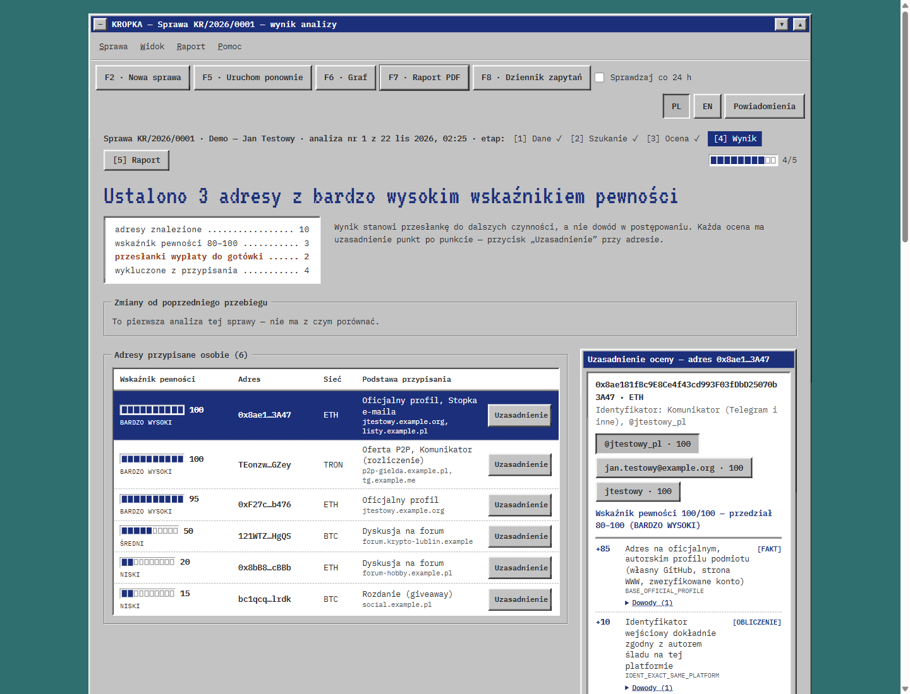

# KROPKA — Osintowy Łapacz Cyfrowych Śladów (OŁCyŚ)

**Przypisuje adresy kryptowalutowe do osoby wyłącznie na podstawie jawnych źródeł — z wyjaśnialnym Wskaźnikiem Pewności, wykrywaniem wyjścia do gotówki i raportem po polsku.**

[](https://github.com/hapole0n/hacknation_2026_bydgoszcz_cebularz_team/actions/workflows/ci.yml)
[](LICENSE)



### Szybki start

```bash
docker compose up --build
```

Potem otwórz **http://localhost:5173** i wybierz „otwórz sprawę demonstracyjną” (dane syntetyczne; w sieci pobierane są tylko publiczne kursy NBP). Pełna instalacja, tryb deweloperski i testy: rozdział [Instalacja i uruchomienie](#instalacja-i-uruchomienie).

> HackNation 2026 · zadanie Ministerstwa Finansów / KAS · zespół **cebularz**
> Nazwa robocza „KROPKA” może się zmienić (jedno miejsce w kodzie: `packages/core/src/app.ts`).
> **Co jest zrobione, a co nie — tabela wymagań z testami: [`docs/ZGODNOSC.md`](docs/ZGODNOSC.md).**

## Opis projektu — jaki problem rozwiązuje i w jaki sposób

**Problem.** Adres kryptowalutowy to ciąg znaków, który sam nie mówi, do kogo należy. Ludzie jednak czasem publikują go otwarcie: w profilu, w ogłoszeniu „sprzedam USDT za gotówkę”, na forum, w stopce e-maila. Analityk Krajowej Administracji Skarbowej, który zajmuje się taką osobą, musiałby ręcznie przeszukać wiele serwisów, sprawdzić, czy znaleziony adres w ogóle da się przypisać człowiekowi (adres giełdy, kontrakt czy zbiórka charytatywna nie należą do osoby), a potem obejrzeć historię transakcji i ocenić, czy środki wychodzą na gotówkę.

**Rozwiązanie.** Aplikacja robi to za analityka, wyłącznie na podstawie informacji jawnych:

1. Analityk wpisuje to, co wie o osobie: imię i nazwisko, nick, identyfikator z komunikatora, login z sieci społecznościowej, e-mail lub sam adres krypto.
2. Aplikacja przeszukuje jawne źródła, znajduje publikacje i **wyciąga z nich adresy kryptowalutowe** (sprawdzając ich poprawność).
3. Dla każdego powiązania „osoba ↔ adres” liczy **Wskaźnik Pewności 0–100** — jawnym, wersjonowanym algorytmem, z rozbiciem na punkty: *dlaczego* tyle, z jakiego źródła i co zwiększyłoby wynik.
4. **Odrzuca fałszywe przypisania:** adresy giełd, portfeli powierniczych, smart kontraktów, zbiórek, adresy przykładowe — dostają 0 punktów, ale kontakt z nimi jest zapisany (np. „środki trafiły na adres depozytowy giełdy” to trop do zapytania o dane KYC).
5. Dla adresów, które da się przypisać, pokazuje **aktywność w blockchainie**: wolumen, wymiany na stablecoiny, kontakty z giełdami, kantorami, P2P, bramkami płatniczymi i kartami, przekroczenia progów 1 000 / 10 000 / 15 000 EUR, wartość w złotych wg kursu NBP.
6. Analizę można **powtarzać cyklicznie**; aplikacja porównuje kolejne wyniki i alarmuje, gdy np. adres publikowany w profilu **się zmienił**.
7. Wynik trafia do **raportu po polsku** (PDF, JSON, widok w aplikacji), który wyraźnie oddziela *fakty ze źródeł*, *wyniki obliczeń* i *wnioski do weryfikacji*, i jest czytelny dla osób bez wiedzy informatycznej.

To narzędzie dostarcza **przesłanki do dalszej weryfikacji, a nie dowody**. Wskaźnik Pewności nie jest rozstrzygnięciem, a progi kwotowe nie są kwalifikacją prawną.

**Co jest przeszukiwane naprawdę.** Prawdziwe źródła: GitHub, Gravatar, ENS, Wayback Machine i (domyślnie wyłączony) Telegram, a po stronie blockchaina — Etherscan, TronGrid, mempool.space oraz kursy NBP. Fora, portale ogłoszeniowe P2P i serwisy społecznościowe w demonstracji **symuluje sztuczny „mini-internet”** (`fixtures/sandbox-web`, dane w całości zmyślone): do tych serwisów nie ma prawdziwych konektorów. Szczegóły: [Ograniczenia](#ograniczenia-i-znane-braki).

## Założenia projektu

- **Wyłącznie OSINT** — jawne i legalne źródła, oficjalne API tam, gdzie istnieją, bez logowania na cudze konta, wycieków, omijania zabezpieczeń i skanowania podatności (rozdz. 7 zadania).
- **Dane testowe i demonstracyjne są syntetyczne.** Prawdziwe źródła uruchamia się świadomie, osobno dla każdej analizy (opt-in); w pokazie dotyczą tylko publicznych adresów instytucjonalnych (giełda, router DEX).
- **Ocena jest deterministyczna i wyjaśnialna** — reguły w pliku YAML, każdy punkt ma uzasadnienie i dowód. AI jest opcjonalne, lokalne, domyślnie wyłączone i niczego nie ocenia.
- **Żadnych danych do niezatwierdzonych usług zewnętrznych:** każde zapytanie wychodzące przechodzi przez jedną bramkę (allowlista, limity, dziennik). Brak telemetrii, brak CDN-ów.
- **Środowisko docelowe KAS:** bez zależności od chmury publicznej; jedno repozytorium, uruchamialne `docker compose`.
- **Etykiety adresów** (giełdy, kontrakty) pochodzą z publicznych list z podanym źródłem i licencją; w produkcji KAS podłączyłaby własne lub licencjonowane źródło tym samym formatem.
- **Zgodnie z art. 11a ustawy o PIT** wartość w PLN liczymy po kursie średnim NBP z ostatniego dnia roboczego *przed* dniem transakcji (dzień kalendarzowy czasu polskiego). Progi AML: ustawa z 1.03.2018 r. o przeciwdziałaniu praniu pieniędzy, art. 35 ust. 1 (numerację punktów do weryfikacji w ISAP) — jako przesłanki analityczne.
- To **prototyp** dla jednego analityka w sieci lokalnej: bez uwierzytelniania i ról.

## Parametry wyszukiwania

### Identyfikatory wejściowe
Co najmniej jeden, dowolnej kombinacji. Każdy jest normalizowany (np. e-mail do małych liter, `@` z handle zdjęty, adres do postaci kanonicznej; adres z błędną sumą kontrolną jest odrzucany już przy wprowadzaniu).

| Typ | Przykład (syntetyczny) |
|---|---|
| `NAME` — imię i nazwisko | `Jan Testowy` |
| `NICK` — nick z forum | `jtestowy` |
| `MESSENGER` — identyfikator z komunikatora | `@jtestowy_pl` |
| `SOCIAL_LOGIN` — login z sieci społecznościowej | `kantor_usdt_lublin` |
| `EMAIL` — adres e-mail | `jan.testowy@example.org` |
| `ADDRESS` — publiczny adres krypto (BTC, ETH, TRON, nazwa ENS) | adres z `fixtures/addresses.json` |

Dla identyfikatora `ADDRESS` wynikiem nie jest lista powiązań, lecz **konta, które ten adres opublikowały** (z oceną), oraz to, co jeszcze te konta publikują.

### Źródła (konektory) i ich polityki
Wybór źródeł jest per analiza; domyślnie tylko sztuczny `sandbox`. Polityka (metoda, regulamin, limit) jest zapisana w kodzie konektora i widoczna w aplikacji; wagę (`weightHint`) widzi analityk, ale **ocenę liczy typ źródła, nie konektor**.

| Konektor | Szuka po | Metoda | Regulamin / dokumentacja | Limit | Klucz | Uwagi |
|---|---|---|---|---|---|---|
| `sandbox` | wszystkim | sztuczny | `fixtures/sandbox-web` | bez limitu | — | sztuczny mini-internet: profil jak GitHub, strona osobista, fora, ogłoszenie P2P, kanał jak Telegram, komentarze konkursowe, stopka e-maila, reklama kantoru |
| `github` | nick, login, imię i nazwisko, e-mail, adres | oficjalne API | [GitHub ToS](https://docs.github.com/en/site-policy/github-terms/github-terms-of-service) | 1/s | `GITHUB_TOKEN` tylko do wyszukiwania adresu w kodzie | profil, README profilu, commity po e-mailu autora; adresy e-mail na domenach zarezerwowanych obsługuje sandbox |
| `gravatar` | e-mail | oficjalne API | [Gravatar API](https://docs.gravatar.com/) | 1/s | `GRAVATAR_API_KEY` (portfele) | bez klucza profil jest czytany, a portfele pomijane z adnotacją |
| `ens` | adres, nick i login będące nazwą `.eth` | oficjalne API (RPC `eth_call`) | [ENS docs](https://docs.ens.domains/) | 2/s | — | odwrotny rekord uznawany tylko, gdy nazwa wraca do adresu |
| `wayback` | strony znalezione przez inne źródła | oficjalne API (CDX) | [Internet Archive ToS](https://archive.org/about/terms.php) | 1/s | — | wcześniejsze kopie stron: jaki adres tam był i kiedy (wykrywanie podmiany) |
| `telegram_public` | identyfikator komunikatora | strony publiczne | [Telegram — Content Licensing](https://telegram.org/tos/content-licensing) | 0,5/s | `TELEGRAM_LIVE=true` | **dostęp na żywo domyślnie wyłączony**, patrz Ograniczenia |

Każda analiza przechodzi cztery rundy: **(1)** szukanie po identyfikatorach, **(2)** odwrotne szukanie każdego znalezionego adresu (kto jeszcze go publikuje — to zasila regułę konfliktu), **(3)** dla adresu na wejściu: konta-publikatory i ich pozostałe publikacje, **(4)** archiwa. Dziennik „Przeszukane źródła” zapisuje, co każde źródło zrobiło z każdym identyfikatorem (znaleziono / brak wyników / pominięto / błąd), więc pusty wynik czyta się jako „przeszukano, nie znaleziono”, a nie jako awarię.

### Blockchain
Tryb per analiza: `fixture` (domyślny, syntetyczne historie z `fixtures/chain`, offline), `live` (najpierw fixtures, potem Etherscan v2 / TronGrid / mempool.space) lub `off`. Brak klucza API to adnotacja w wyniku, nigdy awaria. Klasyfikacja adresu: etykieta → bytecode (`eth_getCode` w Ethereum, kontrola kontraktu w TRON) → heurystyka adresu depozytowego giełdy → heurystyka usługi (wielu jednorazowych kontrahentów).
Progi: **1 000 / 10 000 / 15 000 EUR** (pojedyncza transakcja i suma skumulowana wypływów w stronę usług cash-out), wartość w PLN i EUR wg NBP tabela A; stablecoiny 1:1 do USD, inne aktywa tylko gdy transfer niesie cenę, inaczej „bez wyceny”.

### Wskaźnik Pewności — wersja reguł **1.1.0** (`config/scoring-rules.v1.yaml`)
`wynik = clamp(0…100, baza(typ źródła) + Σ modyfikatory)`; jeśli zachodzi którykolwiek wyjątek — **0** (wykluczone). Wersja reguł jest zapisywana w każdym przebiegu.

| Baza wg typu źródła | pkt |
|---|---|
| Oficjalny profil / własna strona | 85 |
| Ogłoszenie sprzedaży · oferta P2P · stopka e-maila · komunikator (rozliczenie) | 70 |
| Dyskusja na forum | 50 |
| Masowy komentarz · giveaway | 25 |

| Modyfikator | pkt |
|---|---|
| Identyfikator dokładnie zgodny z autorem śladu na tej platformie (`IDENT_EXACT_SAME_PLATFORM`) · e-mail zgodny dokładnie (`IDENT_EMAIL_EXACT`) | +10 |
| Ten sam adres w ≥ 2 **niezależnych** serwisach (`SYNERGY_INDEPENDENT_SOURCES`) — powtórzenia w jednym serwisie się nie liczą | +15 |
| Aktywność adresu w blockchainie zbieżna ze śladem (`CHAIN_ACTIVE_CONSISTENT`, ±90 dni) | +5 |
| Adres nigdy nieużywany w blockchainie (`CHAIN_NEVER_USED`) | −10 |
| Tylko wariant nicku (`IDENT_NICK_VARIANT`) | −5 |
| Ten sam nick na innej platformie, bez potwierdzenia — możliwa inna osoba (`IDENT_NICK_OTHER_PLATFORM`) | −10 |
| Tylko imię i nazwisko (`IDENT_NAME_ONLY`) | −20 |
| Ślad starszy niż 3 lata (`TRACE_OLDER_THAN_3Y`) | −5 |
| Adres przypisywany ≥ 3 niepowiązanym tożsamościom — kopiuj-wklej, scam (`ADDRESS_MULTI_IDENTITY`) | −20 |

**Wyjątki (→ 0):** `EXCL_CEX` giełda · `EXCL_CUSTODIAL_DEPOSIT` adres depozytowy giełdy · `EXCL_CONTRACT` smart kontrakt / router DEX · `EXCL_MIXER` mikser · `EXCL_CHARITY` zbiórka · `EXCL_EXAMPLE` adres przykładowy / burn · `EXCL_SERVICE` kantor, bramka płatnicza, wydawca karty.
**Pasma:** 80–100 bardzo wysokie · 60–79 prawdopodobne · 40–59 średnie (wymaga potwierdzenia drugim śladem) · 10–39 niskie / szum · 0 wykluczone.
**Podpowiedzi** mówią, co zmieniłoby wynik (np. „drugie niezależne źródło podniosłoby wynik o 15 pp”). Decyzja analityka (potwierdzam / odrzucam, kto, kiedy, dlaczego) jest zapisywana **osobno** i nigdy nie zmienia obliczonego wyniku.

## Architektura

```
 przeglądarka (React, PL/EN, Cytoscape.js)
        │ REST
        ▼
 apps/api (NestJS) ──────────────► packages/core  — czysta logika TypeScript, bez I/O:
   │   │   │                        ekstrakcja i walidacja adresów, klasyfikacja kontekstu,
   │   │   │                        Wskaźnik Pewności, wskaźniki blockchain, różnice, raport
   │   │   └─► PostgreSQL 16  (sprawy, przebiegi, dowody, powiązania, raporty, dziennik zapytań)
   │   └─────► EgressClient: allowlista · limit na host · cache · dziennik ──► publiczne API
   └─────────► fixtures/sandbox-web (sztuczny internet, :8088) · opcjonalnie Ollama (lokalny LLM)
```

| Moduł | Rola |
|---|---|
| `apps/api` | REST API, potok analizy (`PipelineService`), konektory Web2, adaptery blockchain, harmonogram, raport PDF (pdfmake) |
| `apps/web` | interfejs: sprawy, przebiegi, wyniki, graf, karta adresu, raport, dziennik zapytań, powiadomienia |
| `packages/core` | logika dziedzinowa, w pełni testowana jednostkowo |
| `config/` | reguły oceny (YAML), allowlista, listy etykiet z nagłówkami źródło / licencja / data |
| `fixtures/` | sztuczny mini-internet, sztuczne historie blockchain, oczekiwane wyniki (`expected.json`), nagrane odpowiedzi API pięciu publicznych adresów |
| `scripts/` | generatory danych syntetycznych, rejestrator odpowiedzi, generator `LICENSES.md` |

Technologie: Node.js / TypeScript (`strict`), NestJS 12, Prisma 7, PostgreSQL 16, React + Vite + Tailwind + shadcn/ui, react-i18next, Cytoscape.js, TanStack Query, Vitest, pnpm workspaces, Docker Compose.
Nowe źródło lub sieć dodaje się przez implementację `SourceConnector` / `ChainAdapter` i `register()`.

## Instalacja i uruchomienie

**Wymagane:** Docker Desktop (Compose v2). Do trybu deweloperskiego dodatkowo: Node.js ≥ 22.12 i pnpm 12 (`corepack enable`).

**Jedno polecenie** (baza, sztuczny internet, API z migracjami, interfejs):

```bash
docker compose up --build
```

Potem: interfejs **http://localhost:5173**, API http://localhost:3000/api/health (`{"status":"ok","db":"up",…}`), sztuczny internet http://localhost:8088. Plik `.env` jest opcjonalny (klucze do źródeł na żywo): `cp .env.example .env`.

Tryb deweloperski i testy:

```bash
pnpm install
docker compose up -d db sandbox
pnpm --filter api exec prisma migrate dev
pnpm dev                 # api :3000 + web :5173
pnpm test                # core, web, api (api wymaga bazy: docker compose up -d db)
pnpm lint
pnpm licenses:report     # regeneruje LICENSES.md
```

Klucze (`.env`, nigdy w repozytorium): `ETHERSCAN_API_KEY`, `TRONGRID_API_KEY` (historia Ethereum i TRON na żywo), `GITHUB_TOKEN`, `GRAVATAR_API_KEY`, `TELEGRAM_LIVE`, `AI_ENABLED` / `AI_BASE_URL` / `AI_MODEL`. Bez nich aplikacja działa na danych syntetycznych.
Opcjonalny lokalny model: uruchom Ollama (lub inny serwer zgodny z API OpenAI) osobno i ustaw `AI_ENABLED=true`, `AI_BASE_URL`, `AI_MODEL`; usługi Ollama nie ma w `docker-compose.yml`.

## Scenariusz demonstracyjny

Wszystko na danych syntetycznych — osoba **„Jan Testowy”** (nick `jtestowy`, e-mail `jan.testowy@example.org`, Telegram `@jtestowy_pl`) i pułapka: inna osoba z tym samym nickiem na innym forum.

1. Ekran „Nowa sprawa” (strona główna) → link **„otwórz sprawę demonstracyjną”**: aplikacja zakłada sprawę `KR/RRRR/NNNN` i od razu uruchamia analizę na źródłach syntetycznych (przy ponownym kliknięciu otwiera ostatnią analizę). Własną sprawę zakłada się, wpisując identyfikatory w jedno pole (rodzaj jest rozpoznawany automatycznie) i naciskając Enter.
2. Obowiązkowe siedem etapów z zadania i to, co widać:

| # | Etap | Co pokazuje aplikacja (wynik zweryfikowany testem `Z-29`, `Z-17`) |
|---|---|---|
| 1 | Wejście identyfikatorów | trzy identyfikatory różnych typów, znormalizowane |
| 2 | Szukanie śladów OSINT | 13 stron ze sztucznego internetu, z adresem URL, czasem pobrania i skrótem SHA-256; dziennik „Przeszukane źródła” |
| 3 | Wykrycie i weryfikacja adresów | adresy ETH / TRON / BTC wyciągnięte z tekstów, sprawdzone (suma kontrolna, sieć) |
| 4 | Wskaźnik Pewności z rozbiciem | A1 → **100** (własna strona + README: 85 +10 +15 +5, obcięte do 100), T1 (ogłoszenie P2P) → **100**, forum B1 → **50** (+ podpowiedź), konkurs B2 → **15**, stary adres A0 → **95** (−5 za ślad starszy niż 3 lata), adres pułapki → **20** |
| 5 | Odrzucenie błędnych przypisań | giełda (Binance 14), router Uniswap, zbiórka charytatywna, kantor → **0 / wykluczone**, z powodem; kontakt zapisany |
| 6 | Wskaźniki blockchain | A1: ETH → wymiana na DEX → USDT → adres depozytowy giełdy; T1: wiele małych wpływów USDT → kantor i adres z ogłoszenia (**USDT → gotówka**); przekroczone progi 1 000 / 10 000 / 15 000 EUR, wartości w PLN, chronologia |
| 7 | Źródła i wynik | karta adresu ze źródłami, graf powiązań, **raport** HTML / PDF / JSON z podziałem FAKT / OBLICZENIE / WNIOSEK i skrótem SHA-256 |

3. **Monitoring i zmiana w czasie:** na stronie sprawy ustaw harmonogram (co 15 min / 1 h / 24 h) albo na ekranie wyniku zaznacz „Sprawdzaj co 24 h”; **F5** („Uruchom ponownie”) uruchamia analizę od razu; przycisk **„Demo: symuluj zmianę”** (strona sprawy) podmienia stronę persony (ten sam URL, inny sztuczny adres). Kolejna analiza pokazuje blok „Zmiany od poprzedniego przebiegu”, powiadomienia (dzwonek) i sekcję 8 raportu.
4. **Wariant „adres na wejściu”:** „Demonstracja: kto stoi za adresem?” — konta, które adres opublikowały, z oceną.
5. **Część „na żywo”** (opcjonalnie, z kluczem Etherscan): nowa sprawa z identyfikatorem `ADDRESS` = publiczny portfel giełdy lub router Uniswap (adresy z `fixtures/expected.json` → `realAddresses`), blockchain: „live” — adres z etykiety (giełda, router) jest odrzucany od razu i bez zapytania; adres kontraktu bez etykiety (np. kontrakt USDT w TRON) jest odrzucany po kontroli kontraktu. Dziennik zapytań pokazuje każde wychodzące zapytanie.

## Przykłady (zrzuty ekranu / logi)

Zrzuty z rzeczywistego przebiegu aplikacji na **czystej bazie** i danych syntetycznych (`docs/screenshots/`):

| Plik | Co pokazuje |
|---|---|
| `01-nowa-sprawa.png` | ekran „Nowa sprawa”: jedno pole na wszystkie identyfikatory z automatycznym rozpoznaniem rodzaju, pole „Numer postępowania / podstawa”, wybór źródeł |
| `02-ustawienia-zaawansowane.png` | „Ustawienia zaawansowane”: nazwa sprawy, ręczna zmiana rodzaju identyfikatora, wybór źródeł z ich politykami, tryb blockchain |
| `03-wynik.png` | „Wynik analizy”: werdykt, liczniki, adresy przypisane osobie z Wskaźnikiem Pewności |
| `04-uzasadnienie-i-decyzja.png` | okno „Uzasadnienie oceny”: rozbicie punktowe z oznaczeniami [FAKT] / [OBLICZENIE], komentarz analityka, „Potwierdź / Odrzuć przypisanie” |
| `05-przeslanki-wyplaty-wykluczone.png` | przesłanki wypłaty do gotówki z przekroczonymi progami oraz adresy wykluczone z przypisania (z powodem i źródłem etykiety) |
| `06-przeszukane-zrodla.png` | „Przeszukane źródła”: co każde źródło zrobiło z każdym identyfikatorem i o której godzinie |
| `07-karta-adresu.png`, `08-karta-adresu-przebieg.png` | „Karta adresu”: sumy, przebieg transakcji z wyceną NBP, progi AML, kontrahenci, rekomendowane czynności |
| `09-graf.png` | graf powiązań (Cytoscape.js) |
| `10-kto-stoi-za-adresem.png` | wariant „adres na wejściu”: konta, które go opublikowały |
| `11-raport-html.png`, `12-raport-decyzje.png` | raport w aplikacji, z decyzjami analityka |
| `13-raport-pdf-strona-1.png`, `14-raport-pdf-ocena.png`, `15-raport-pdf-decyzje.png` | raport PDF (jasny, te same czcionki i kolory; strony wyrenderowane z pliku) |
| `16-dziennik-zapytan.png` | Dziennik zapytań: zapytania z rzeczywistych analiz, z sygnaturą sprawy i numerem postępowania |
| `17-rejestr-spraw.png` | Rejestr spraw: sygnatura, podstawa, ostatni wynik, monitoring |
| `18-sprawa-monitoring-i-zmiana.png` | sprawa: harmonogram monitoringu, historia analiz, przycisk „Demo: symuluj zmianę” |
| `19-zmiany-od-poprzedniego-przebiegu.png` | blok „Zmiany od poprzedniego przebiegu”: zmiana adresu w tym samym źródle, nowy adres, nowe transakcje, przekroczone progi |
| `20-powiadomienia.png` | powiadomienia po zmianie |
| `21-raport-sekcja-zmiany.png` | raport, sekcja „Zmiany od poprzedniego przebiegu” |
| `22-pomoc-skroty.png` | klawisze F1–F10 i zamienniki Alt+cyfra |

**Rozbicie punktowe** (fragment wyniku przebiegu demonstracyjnego; te liczby sprawdza test `Z-17` na podstawie `fixtures/expected.json`):

```
NICK:jtestowy → A1                                    100  bardzo wysokie
  BASE_OFFICIAL_PROFILE          +85   strona osobista + README profilu (2 niezależne serwisy)
  IDENT_EXACT_SAME_PLATFORM      +10   nick = autor, potwierdzony e-mailem
  SYNERGY_INDEPENDENT_SOURCES    +15
  CHAIN_ACTIVE_CONSISTENT         +5   aktywność on-chain w ciągu 90 dni od śladów
  CLAMP                          −15   115 → 100

NICK:jtestowy → B1 (forum)                             50  średnie
  BASE_FORUM_DISCUSSION          +50   podpowiedź: drugie niezależne źródło podniosłoby wynik o 15 pp

MESSENGER:jtestowy_pl → BINANCE_14 (portfel giełdy)     0  wykluczone
  EXCL_CEX                              adres publiczny giełdy scentralizowanej; kontakt zapisany
```

**Wynik testów akceptacyjnych** (`pnpm --filter api exec vitest run test/zadanie.acceptance.test.ts`, fragment):

```
✓ Z-01 wejście: sześć typów identyfikatorów, każdy samodzielnie
✓ Z-13 odrzucanie: giełdy, adresy depozytowe, kontrakty, instytucjonalne, mikser, przykłady, usługi
✓ Z-14 (opcjonalnie) zmiana adresu w czasie wykryta, stary i nowy adres nazwane
✓ Z-17 Wskaźnik liczony zgodnie z algorytmem: wynik, pasmo i reguły każdego powiązania = fixtures/expected.json
✓ Z-29 obowiązkowy scenariusz, siedem etapów w jednym przebiegu
↓ Z-32a…d  pakiet zgłoszeniowy (tytuł i opis, prezentacja PDF, film, link) — jeszcze nie gotowy
```
(Nazwy testów w repozytorium są po angielsku; powyżej skrócone i przetłumaczone.)

## Zgodność i bezpieczeństwo

- **Wyłącznie OSINT.** Jawne, legalne źródła; oficjalne API tam, gdzie istnieją; regulaminy źródeł sprawdzane ręcznie przy dodawaniu konektora. Bez logowania na cudze konta, wycieków, omijania zabezpieczeń i skanowania podatności.
- **Dane syntetyczne.** Fixtures, testy i demo używają wyłącznie danych sztucznych; e-maile na domenach zarezerwowanych. Dla podmiotów syntetycznych konektory nie odpytują prawdziwych usług — odpowiada sztuczny internet.
- **Brak wysyłania danych do niezatwierdzonych usług.** Każde zapytanie wychodzące przechodzi przez `EgressClient`: allowlista hostów (`config/egress-allowlist.yaml`), limit zapytań na host, cache, wpis w dzienniku; przekierowania sprawdzane na każdym skoku. Brak telemetrii, brak skryptów i czcionek z CDN (czcionki serwowane lokalnie).

  | Host | Po co |
  |---|---|
  | `api.etherscan.io` | Ethereum: transakcje, transfery ERC-20, bytecode |
  | `mempool.space` | Bitcoin: transakcje adresu |
  | `api.trongrid.io` | TRON: transakcje, TRC-20, kontrola kontraktu |
  | `api.github.com`, `raw.githubusercontent.com` | publiczne profile GitHub |
  | `api.gravatar.com` | profil Gravatar po skrócie e-maila |
  | `web.archive.org` | kopie stron (Wayback, CDX) |
  | `t.me` | publiczne strony Telegrama (tylko z `TELEGRAM_LIVE=true`) |
  | `api.nbp.pl` | kursy średnie NBP (wycena PLN) |
  | `ethereum-rpc.publicnode.com` | rozpoznawanie nazw ENS (`eth_call`) |
  | `api.coingecko.com` | opcjonalne ceny historyczne (nieużywane, wyłączone) |
  | `localhost`, `sandbox-web`, `ollama` | sztuczny internet i lokalny model |

- **Dziennik zapytań.** Strona „Dziennik zapytań” pokazuje każde zapytanie: czas, sprawę, źródło, serwer, ścieżkę bez parametrów i wynik (blokady allowlisty i błędy sieci wyróżnione). Dziennik nie przechowuje treści odpowiedzi ani parametrów (mogą w nich być klucze).
- **AI wyłącznie lokalne i opcjonalne** (domyślnie wyłączone), przez API zgodne z OpenAI — model wymienia się konfiguracją (`AI_BASE_URL`, `AI_MODEL`). Podpowiada tylko typ kontekstu tam, gdzie reguły słów kluczowych nic nie znalazły; oznaczone „Sugestia AI”, nie zmienia oceny.
- **Minimalizacja danych.** Zapisujemy fragmenty ±200 znaków i SHA-256 pełnej treści, nie całe strony. Decyzje analityka są osobno i nie zmieniają wyniku.
- **Podstawy prawne użyte w narzędziu:** art. 35 ust. 1 ustawy o przeciwdziałaniu praniu pieniędzy (progi 1 000 / 10 000 / 15 000 EUR — jako przesłanki analityczne, nie kwalifikacja prawna); art. 11a ust. 1 ustawy o PIT (kurs NBP z ostatniego dnia roboczego przed dniem transakcji); regulaminy źródeł (linki w tabeli konektorów). Brzmienie przepisów i numerację punktów należy zweryfikować w ISAP przed użyciem produkcyjnym.
- **Atrybucja:** dane Ethereum pochodzą z Etherscan API — stopka każdego ekranu zawiera napis „Powered by Etherscan.io APIs”.
- **Klucze** tylko w `.env` (szablon: `.env.example`), nigdy w repozytorium.

## Ograniczenia i znane braki

Pełna lista: [`docs/ZGODNOSC.md`](docs/ZGODNOSC.md). Najważniejsze:

- **Telegram na żywo jest domyślnie wyłączony** (`TELEGRAM_LIVE=false`). `t.me/robots.txt` odpowiada 404 (sprawdzono 21.11.2026), ale regulamin Telegrama („Content Licensing and AI Scraping”) ogranicza dostęp do treści użytkowników do zwykłego korzystania z platformy. Sztuczne nazwy obsługuje mini-internet; prawdziwa nazwa bez włączonego dostępu jest w dzienniku „pominięto”. Układ stron `t.me` sprawdzono tylko na fixtures.
- **Etykiety giełd w sieci TRON są niekompletne.** OKX: publiczny plik Proof of Reserves (79 dużych portfeli z ok. 474 tys.). Binance: oficjalny, publiczny bez logowania jest tylko wpis „Our Commitment To Transparency” z listopada 2022 r. — 8 adresów TRX, jawnie „niekompletny zbiór danych”; aktualny plik PoR jest za logowaniem i **nie jest używany**. Pozostałe portfele Binance w TRON wykrywa heurystyka (adres depozytowy / zachowanie usługi), więc mogą być sklasyfikowane słabiej.
- **Fora, portale P2P i serwisy społecznościowe nie mają prawdziwych konektorów** — w demo symuluje je sztuczny internet.
- **Brak list mikserów i OFAC** (reguła `EXCL_MIXER` istnieje, listy nie załadowano), brak etykiet giełd w sieci Bitcoin, brak prawdziwych list bramek płatniczych, kart krypto i polskich kantorów (jedyny kantor jest syntetyczny).
- **Bitcoin (`mempool.space`)** zweryfikowany tylko na atrapach (usługa była nieosiągalna z sieci deweloperskiej). **Brak cen CoinGecko** — aktywa inne niż stablecoiny bywają „bez wyceny”.
- **Raport tylko po polsku**; interfejs PL / EN. Przejście przez interfejs sprawdzaliśmy ręcznie, bez automatycznych testów w przeglądarce.
- **AI** sprawdzone tylko na atrapie modelu; wybór modelu nierozstrzygnięty; serwera Ollama nie ma w `docker-compose.yml`.
- **Retencja i usuwanie:** pole `retentionDays` jest zapisywane, ale nic go nie egzekwuje; API nie ma usuwania sprawy. Brak uwierzytelniania.

## Licencje wykorzystanych komponentów

**Licencja projektu:** [`LICENSE`](LICENSE) — Copyright © 2026 Oleh Kropyva, wszelkie prawa zastrzeżone; kod udostępniony do oceny w konkursie HackNation 2026 (w razie nagrodzenia prawa majątkowe przechodzą na Skarb Państwa — Ministerstwo Finansów zgodnie z Regulaminem). Wiążący jest tekst pliku `LICENSE`.

Wszystkie zależności są Open Source; pełna lista z licencjami, obrazy Docker, czcionki oraz źródła i licencje list etykiet: [`LICENSES.md`](LICENSES.md) (generowany: `pnpm licenses:report`).

## Wykorzystane zasoby

Źródła, progi, formaty i limity API: [`docs/research-notes.md`](docs/research-notes.md). W skrócie:
ustawa o przeciwdziałaniu praniu pieniędzy (art. 35 ust. 1) · ustawa o PIT (art. 11a) · API NBP (tabela A) · Etherscan API v2 (Powered by Etherscan.io APIs) · TronGrid · mempool.space · GitHub REST · Gravatar API · ENS · Wayback CDX · listy etykiet: `dawsbot/eth-labels` (MIT), `brianleect/etherscan-labels` (MIT), dokumentacja wdrożeń Uniswap, publiczny plik Proof of Reserves OKX, wpis „Our Commitment To Transparency” Binance (pełne źródła i licencje w nagłówkach `config/labels/*.json`).

## Dokumentacja techniczna

- [`PLAN.md`](PLAN.md) — zakres, architektura, model danych, algorytm, harmonogram.
- [`docs/ZGODNOSC.md`](docs/ZGODNOSC.md) — wymaganie → realizacja → test → status.
- [`docs/pitch/KROPKA_HackNation2026.pdf`](docs/pitch/KROPKA_HackNation2026.pdf) — prezentacja dla jury (10 slajdów, 1920×1080), podglądy w `docs/pitch/preview/`, notatki w [`docs/pitch/NOTATKI.md`](docs/pitch/NOTATKI.md). Budowanie: `pnpm pitch` (kadry produktu: `pnpm pitch:capture` na osobnej, czystej bazie).
- [`docs/OLCyS_zadanie.pdf`](docs/OLCyS_zadanie.pdf), [`docs/TZ_RU.md`](docs/TZ_RU.md) — treść zadania i jej tłumaczenie.
- **Testy:** `packages/core/test` (logika), `apps/api/test` (przebieg na bazie PostgreSQL; `zadanie.acceptance.test.ts` — po jednym teście na wymaganie; `real-addresses.test.ts` — odrzucanie fałszywych trafień na pięciu prawdziwych adresach publicznych z nagranych odpowiedzi API, bez sieci), `apps/web/test`. Nagrywanie odpowiedzi: `node scripts/record-real-addresses.mjs`.
- **Interfejs:** wygląd klasycznego okna z terminalowymi akcentami (specyfikacja: [`docs/design/SPEC.md`](docs/design/SPEC.md); czcionki IBM Plex Mono i VT323 serwowane lokalnie). Ekrany: Nowa sprawa (`/`), Rejestr spraw (F4), Wynik analizy, Karta adresu, Graf (F6), Raport, Dziennik zapytań (F8), Powiadomienia (F9). Każda sprawa dostaje **sygnaturę `KR/RRRR/NNNN`** (numeracja automatyczna, osobno w każdym roku); opcjonalny **numer postępowania / podstawa** zapisuje się w sprawie, w Dzienniku zapytań i w raporcie; decyzję „Potwierdź / Odrzuć przypisanie” uzupełnia komentarz analityka. **Klawisze:** F1 pomoc, F2 nowa sprawa, F3 kopiuj adres, F4 rejestr, F5 uruchom ponownie, F6 graf, F7 raport PDF, F8 dziennik, F9 powiadomienia, F10 ustawienia, Esc wstecz. Gdy przeglądarka zachowuje któryś klawisz dla siebie (np. F6 lub F10), aplikacja to wykrywa i w etykietach pokazuje zamiennik **Alt+cyfra** (Alt+6, Alt+0); zamienniki działają zawsze.
- **Monitoring i zmiany:** harmonogram w bazie (`Case.scheduleEveryMin`, `nextRunAt`) wykonuje jedno okresowe sprawdzenie w procesie API (`SCHEDULER_TICK_MS`, domyślnie 30 s); po każdym przebiegu powstaje różnica z poprzednim (nowe / zniknięte adresy, zmiany oceny z podaniem reguły, nowe transakcje, przekroczone progi, zmiana adresu w tym samym źródle) i powiadomienia w aplikacji (dzwonek): nowy adres z oceną ≥ 60, zmiana adresu, nowy próg, nowy sygnał wyjścia do gotówki.
- **Raport:** `GET /api/runs/:id/report` (dokument + SHA-256 danych), `/report.pdf`, `/report.json`; PDF powstaje lokalnie (pdfmake, osadzone czcionki IBM Plex Mono i VT323), bez przeglądarki i bez wysyłania danych na zewnątrz.
- **Główne endpointy API:** `GET /api/connectors`, `GET /api/chain-adapters`, `POST /api/cases`, `POST /api/cases/:id/runs` (`connectors`, `chain`), `GET /api/runs/:id`, `GET /api/runs/:id/diff`, `POST /api/links/:id/decision`, `PUT /api/cases/:id/schedule`, `GET /api/audit-log`, `GET /api/notifications`.
- **Dodawanie reguł i etykiet:** reguły oceny — `config/scoring-rules.v1.yaml` (każda zmiana = nowa wersja); listy etykiet — nowy plik w `config/labels/` z nagłówkiem (`source`, `license`, `retrieved`), bez którego aplikacja nie wystartuje.
